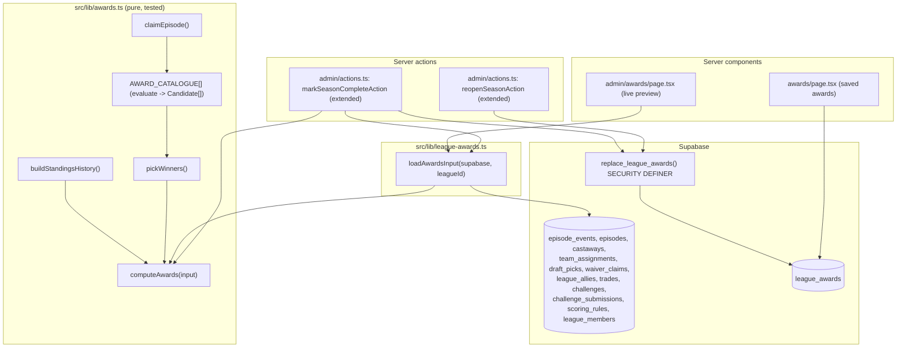

# Design Document: Season Awards

## Overview

Season awards are fun, non-scoring recognitions computed from data the app already stores. The League_Admin can preview them at any time. They are saved when the admin completes the season, and players see them only after that.

Three project rules shape the design:

1. **Data-layer separation** (`.kiro/steering/structure.md`): all award logic is pure and lives in `src/lib/awards.ts` with no Supabase imports. A separate loader (`src/lib/league-awards.ts`) fetches data using the same structural `SupabaseLike` pattern already used by `src/lib/league-standings.ts`. Server actions and pages stay thin.
2. **No second scoring implementation**: weekly standings are built by calling the existing `computePlayerScore`, `computeAllyPoints`, `resolveAllyEndEpisode`, and `computeLeaderboard`. Awards cannot drift from the leaderboard.
3. **Computed first, saved at completion**: the preview always computes live. Saving at completion freezes results so a later rescore cannot change something people already saw.

Decisions made along the way:

- **No new tracking.** Everything comes from existing tables. Ownership history comes from `episode_events.player_id` (stamped at finalization), `draft_picks`, `waiver_claims`, and `league_allies`.
- **Awards are data, not branching code.** Each award is an entry in a catalogue with an `evaluate` function returning Candidates. One shared function picks Winners, so shared-tie behavior is implemented once.
- **Thresholds live in one constants object** (`AWARD_THRESHOLDS`) so they can be tuned after looking at the admin preview.
- **Display metadata (name, description, category) lives in code**, keyed by `award_key`. The database stores only keys, players, and stats.
- **Winner rule:** among Qualifiers, the best statistic wins and every tie shares the award. Comeback Kid uses the largest rank jump, not "all who qualify".
- **Rule matching by name.** Immunity, Voted Out, and Season Winner events are recognized by case-insensitive scoring rule name, because rule names are admin-editable. This is a known dependency (see Risks).

## Architecture



### Layer responsibilities

- **`src/lib/awards.ts`**: types, `AWARD_THRESHOLDS`, `AWARD_CATALOGUE`, `buildStandingsHistory`, `claimEpisode`, `pickWinners`, `computeAwards`. No Supabase, no I/O.
- **`src/lib/league-awards.ts`**: `loadAwardsInput(supabase, leagueId)` runs the queries and maps rows to `AwardsInput`. It contains no award rules.
- **`admin/actions.ts`**: `markSeasonCompleteAction` loads input, runs `computeAwards`, and calls `replace_league_awards` before marking the league complete. `reopenSeasonAction` calls `replace_league_awards` with an empty list.
- **`admin/awards/page.tsx`**: admin-only live preview, no writes.
- **`awards/page.tsx`**: redirects to the leaderboard unless the league is complete. Otherwise reads `league_awards`, joins display names, and renders by catalogue metadata.
- **`leaderboard/page.tsx`**: shows a link to the awards page at the top when the league is complete.
- **`admin/page.tsx`**: adds an "Awards preview" link. There is no change to `league-nav.tsx`.

## Data Models

### Migration `20240024_add_league_awards.sql`

```sql
CREATE TABLE IF NOT EXISTS league_awards (
  id          uuid PRIMARY KEY DEFAULT gen_random_uuid(),
  league_id   uuid NOT NULL REFERENCES leagues(id)  ON DELETE CASCADE,
  award_key   text NOT NULL,
  player_id   uuid NOT NULL REFERENCES profiles(id) ON DELETE CASCADE,
  stat_value  numeric,
  stat_detail text,
  created_at  timestamptz NOT NULL DEFAULT now(),
  UNIQUE (league_id, award_key, player_id)
);

ALTER TABLE league_awards ENABLE ROW LEVEL SECURITY;

CREATE POLICY "league_awards_select" ON league_awards FOR SELECT
  USING (EXISTS (SELECT 1 FROM league_members lm
                 WHERE lm.league_id = league_awards.league_id
                   AND lm.player_id = auth.uid()));
-- No INSERT/UPDATE/DELETE policies: writes only via replace_league_awards().

CREATE OR REPLACE FUNCTION public.replace_league_awards(p_league_id uuid, p_awards jsonb)
RETURNS jsonb LANGUAGE plpgsql SECURITY DEFINER SET search_path = '' AS $$
BEGIN
  IF NOT EXISTS (SELECT 1 FROM public.leagues
                  WHERE id = p_league_id AND admin_id = auth.uid()) THEN
    RETURN jsonb_build_object('error', 'Only the league admin can save awards');
  END IF;
  DELETE FROM public.league_awards WHERE league_id = p_league_id;
  INSERT INTO public.league_awards (league_id, award_key, player_id, stat_value, stat_detail)
  SELECT p_league_id, a->>'award_key', (a->>'player_id')::uuid,
         NULLIF(a->>'stat_value','')::numeric, a->>'stat_detail'
    FROM jsonb_array_elements(p_awards) a;
  RETURN jsonb_build_object('ok', true);
END; $$;
REVOKE EXECUTE ON FUNCTION public.replace_league_awards(uuid, jsonb) FROM PUBLIC;
GRANT  EXECUTE ON FUNCTION public.replace_league_awards(uuid, jsonb) TO authenticated;
```

The function pattern matches `end_ally` and `execute_trade_swap`, which already avoid relying on `is_league_admin()` under RLS.

### Core types (`src/lib/awards.ts`)

```ts
export type AwardCategory = "standings" | "waiver" | "alliance" | "challenges" | "scoring";

export interface AwardsInput {
  league: { roster_size: number; waiver_budget: number; consolation_points: number };
  players: { player_id: string; display_name: string }[];
  finalizedEpisodes: { number: number; finalized_at: string | null }[];
  castaways: { id: string; name: string; eliminated_episode: number | null }[];
  events: { episode_number: number; castaway_id: string; points: number;
            player_id: string | null; rule_name: string | null }[];
  assignments: { player_id: string; castaway_id: string; points_from_episode: number;
                 source: "draft" | "admin_assign" | "trade" | "waiver" }[];
  draftPicks: { player_id: string; castaway_id: string; pick_number: number }[];
  claims: { player_id: string; castaway_id: string; drop_castaway_id: string;
            bid_amount: number; status: "pending" | "won" | "lost";
            processed_at: string | null }[];
  allies: { player_id: string; castaway_id: string; points_from_episode: number;
            ended_at: string | null }[];
  trades: { proposer_id: string; receiver_id: string; status: string }[];
  challenges: { id: string; episode_number: number }[];
  submissions: { challenge_id: string; player_id: string; is_correct: boolean | null }[];
  challengePoints: Map<string, number>; // challenge_id -> points
}

export interface Candidate { player_id: string; value: number; detail: string; qualifies: boolean }
export interface AwardDefinition {
  key: string; name: string; description: string; category: AwardCategory;
  thresholdText: string;
  direction: "highest" | "lowest";
  evaluate(input: AwardsInput, history: StandingsHistory): Candidate[];
}
export interface AwardResult {
  key: string; candidates: Candidate[]; winners: Candidate[]; unclaimed: boolean;
}
```

`computeAwards(input): AwardResult[]` builds the history once, runs every definition, and applies `pickWinners`.

### `pickWinners(candidates, direction)`

1. Keep Candidates with `qualifies === true`.
2. If none, return `[]`.
3. Find the best `value` (max or min by `direction`) and return every qualifier with that value.

This is the only place ties are handled. Candidates are sorted for display (best first, then name), but Winners do not depend on input order.

### Standings history

`buildStandingsHistory(input)` returns, for each Week `n` in ascending order, a map `player_id -> { total, rank, weeklyScore }`.

For each Week `n`, and each player:

1. `computePlayerScore(playerId, assignments, events, eliminated, finalizedUpToN, consolation, challengeSubsUpToN, n)` gives castaway breakdowns and the base total. Challenge submissions are limited to challenges with `episode_number <= n` and `is_correct === true`.
2. Alliance points use `computeAllyPoints(breakdown, ally.points_from_episode, through)` for each alliance. For Weeks before the last one, `through = min(n, resolveAllyEndEpisode(ended_at))`. For the final Week, `through = resolveAllyEndEpisode(ended_at)` exactly as the leaderboard does, so the last Week matches `computeLeagueLeaderboard`.
3. `rank` comes from `computeLeaderboard` over all players for that Week.
4. `weeklyScore = total(n) - total(previous Week)`.

### `claimEpisode(processedAt, finalizedEpisodes)`

Returns the lowest-numbered Week whose `finalized_at` is later than `processedAt`, or `null` if none (the claim is then ignored by awards that need it).

## Award Catalogue

Initial thresholds (all in `AWARD_THRESHOLDS`):

| Key | Statistic | Threshold | Direction |
|---|---|---|---|
| `king_of_the_hill` | Weeks at rank 1 | >= 3 | highest |
| `peaked_too_early` | Weeks at rank 1, final rank > 3 | >= 3 weeks | highest |
| `comeback_kid` | worst rank - final rank | bottom 3 once, final top 3, >= 6 players | highest |
| `cellar_dweller` | Longest run in last place | >= 5 weeks | highest |
| `cliff_diver` | Largest one-week rank drop | >= 6 places | highest |
| `rock_bottom` | Lowest Weekly_Score | <= -8 | lowest |
| `photo_finish` | Gap between adjacent top-3 places | <= 2 points | lowest |
| `rollercoaster` | Best week - worst week (>= 5 weeks) | >= 30 | highest |
| `on_fire` | Best Weekly_Score | >= 25 | highest |
| `big_spender` | Sum of winning bids | the whole budget | highest |
| `sucker_bid` | Highest winning bid on a castaway out in claim week or next | bid >= 25 | highest |
| `one_that_got_away` | Points the dropped castaway scored for others after drop | >= 15 | highest |
| `going_down_with_the_ship` | Weeks holding an eliminated castaway | >= 3 | highest |
| `hoarder` | Won waiver claims | >= 3 | highest |
| `dumpster_diver` | Points from castaways another player dropped | >= 20 | highest |
| `waiver_mvp` | Best single pickup, points while owned | >= 25 | highest |
| `commitment_issues` | Approved trades | >= 2 | highest |
| `kiss_of_death` | Alliances whose castaway was out by start | >= 2 | highest |
| `coattail_rider` | Alliance points share of total | >= 25% | highest |
| `sole_survivor_whisperer` | Owns or is allied with "Season Winner" castaway | event exists | n/a (all qualifiers) |
| `the_oracle` | Accuracy (correct / graded) | >= 8 graded | highest |
| `lone_wolf` | Challenges where only you were right | >= 1 (needs >= 4 graded) | highest |
| `black_sheep` | Challenges where only you were wrong | >= 1 (needs >= 5 graded) | highest |
| `participation_trophy` | Lowest accuracy among players who answered all, bottom half | >= 5 challenges | lowest |
| `immunity_magnet` | Immunity win events (team + individual) | >= 8 | highest |
| `blindside_victim` | Voted Out events | >= 3 | highest |
| `jinx` | Won claims out in claim week or next | >= 2 | highest |

Implementation notes for the less obvious awards:

- **Ownership-based points** (Waiver MVP, Dumpster Diver): sum `events.points` where `player_id` equals the player and `castaway_id` equals the claimed castaway. This uses the stamped attribution, so it excludes the previous owner's points.
- **One That Got Away**: sum events for the dropped castaway where the Week is `>= claimEpisode` and `player_id !== claimant`. Events with no owner count.
- **Dumpster Diver**: castaway C qualifies for player P when P has a won claim for C processed after another player Q's won claim that dropped C.
- **Going Down With the Ship**: for each current `assignment` whose castaway has `eliminated_episode = e`, count finalized Weeks `n > e` with `n >= points_from_episode`.
- **Photo Finish**: sort final totals, take the top 3 places, compute adjacent gaps, and return both players for each smallest gap that is `<= 2`.
- **Sole Survivor Whisperer**: find events with rule name "Season Winner" (case-insensitive). The winner castaway's attributed owner, plus any player with an active alliance (`ended_at === null`) on that castaway, qualify. Value is 1 for all, so all are Winners.
- **Kiss of Death**: join each alliance to its castaway and test `eliminated_episode !== null && eliminated_episode <= points_from_episode`.
- **Participation Trophy**: "bottom half" means final competition rank greater than `players.length / 2`.
- Challenge awards use only submissions with `is_correct !== null`.

## Pages

### Admin preview: `/league/[id]/admin/awards`

Server component. Uses `requireLeagueAdmin`, `loadAwardsInput`, and `computeAwards`. Layout:

- Summary line: "N awards would be given, M unclaimed."
- One card per award, grouped by category. Each card shows name, description, threshold text, a "Would be given" or "Unclaimed" badge, the Winners with detail text, and up to the top 3 Candidates with a "below threshold" tag where `qualifies` is false.
- An empty state when there are no finalized episodes.
- A note that nothing is saved until the season is completed.

### Player page: `/league/[id]/awards`

Server component, wrapped in `AppShell` with a back link to the leaderboard. There is no nav tab. If `is_complete` is false, it redirects to `/league/[id]/leaderboard` and shows nothing. If complete, it reads `league_awards`, groups rows by `award_key`, looks up display metadata in the catalogue (skipping unknown keys), and renders cards grouped by category.

### Leaderboard link

`leaderboard/page.tsx` already loads the league. It adds `is_complete` to its select and, when true, renders a banner link at the top ("The season is over. See the awards") that points to `/league/[id]/awards`.

### Existing code changes

- `markSeasonCompleteAction`: compute awards after the existing winner computation, call `replace_league_awards`, and only then set `is_complete`. On RPC error, redirect with `?error=`.
- `reopenSeasonAction`: call `replace_league_awards` with `[]` before clearing the completion fields.
- `leaderboard/page.tsx`: add the completed-season awards link at the top.
- Admin hub page: add a link to the preview.

## Error Handling

| Situation | Behavior |
|---|---|
| Fewer than 4 players or no finalized episodes | `computeAwards` returns every award Unclaimed. Preview shows an empty state. |
| `replace_league_awards` returns an error | Completion is aborted, the league stays open, `?error=` banner shown. |
| Unknown `award_key` in `league_awards` | Skipped when rendering. |
| Claim processed after the last finalized episode | `claimEpisode` returns null, and claim-timing awards ignore the claim. |
| Season Winner rule not scored | `sole_survivor_whisperer` is Unclaimed. |
| Player removed from league | Cascade delete removes their rows. |

## Risks

- **Rule names are admin-editable.** Immunity, Voted Out, and Season Winner are matched by case-insensitive name. A league that renames them loses those awards silently. This is acceptable now. A rule "kind" column would fix it if needed later.
- **Claim timing uses timestamps** (`processed_at` versus `finalized_at`). If an admin finalizes an episode long after it airs, claim weeks can shift by one. The preview lets the admin spot oddities.
- **Weekly-swing awards** (On Fire, Rollercoaster, Rock Bottom) include one-off rule bonuses such as "Jeff Says Your Name". This is intentional.
- **Legacy data** without stamped `player_id` falls back to the existing `computePlayerScore` behavior, so ownership-based awards may under-count older seasons.

## Testing Strategy

Unit tests in `src/test/awards.test.ts` (pure functions only, no Supabase mocking), with `fast-check` properties tagged `// Feature: season-awards, Property N`:

1. **Winners are the best qualifiers**: every Winner is a Qualifier with the best value, and no qualifier beats them.
2. **Ties share**: all qualifiers tied on the best value are Winners.
3. **Unclaimed**: with no qualifiers, there are no Winners and `unclaimed` is true.
4. **Order independence**: shuffling players, events, claims, and submissions does not change Winners.
5. **History consistency**: the final Week's totals equal a direct sum from `computePlayerScore` plus ally points.
6. **Input immutability**: `computeAwards` does not mutate its input.

Plus example-based tests per award: given, below threshold, and shared tie. An integration test in `src/test/integration/` creates a small league and checks that final-Week history equals the leaderboard, that completion saves rows, and that reopening deletes them.
